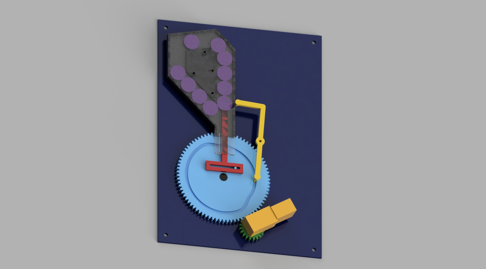
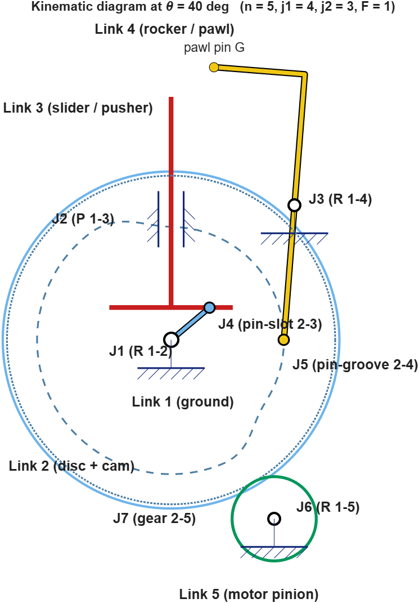

# Scotch Yoke Coin Dispenser

Group "สมิงกินแซ่บ" · 2103-322 Term Project 2569 (Chulalongkorn University).

A coin elevator: Scotch yoke + face-cam pawl.



A disc turns at 30 rpm. It is both a crank and a face cam.
- **Lift:** the crank pin drives a Scotch-yoke slider. Its stem pushes a column of coins up by one coin per turn.
- **Hold:** a follower pin in the cam groove swings a rocker. The rocker's "7" hook is a pawl that holds the column while the stem goes back down.
- **Feed:** at bottom dead centre the next coin rolls down a 45 deg feed onto the stem.
- **Drive:** a yellow TT gear motor turns the disc through a 20/78 spur pair.

The mechanism idea comes from the YouTube Short `-bVXbZl_fIA` by "How Everything Works". All dimensions are our own.

Every number comes from `params.m`, the single source of truth. The symbolic analysis, the Simscape model, the CAD and the built model all use it.

## Team

| Name | Student ID | Individual part |
|---|---|---|
| Knek Nganphokin | 6730274421 | Part IV: built mechanism |
| Pongsapon Phanpreugsachat | 6730326421 | Part II: symbolic math |
| Putanes Boonbarn | 6730419121 | Part III: Simscape Multibody |

The individual marks follow the parts above. Everything else, including Part I, is group work.

## Part I: Basics (kinematic diagram, DoF)



**Links**

| No. | Link | Joint to ground |
|---|---|---|
| 1 | ground | (reference) |
| 2 | disc (crank + face cam + gear rim) | R 1-2 |
| 3 | slider | P 1-3 |
| 4 | rocker (pawl) | R 1-4 |
| 5 | motor pinion | R 1-5 |

- **Lower pairs:** R 1-2, P 1-3, R 1-4, R 1-5, so j1 = 4.
- **Higher pairs:**
  - crank pin in the yoke slot, 2-3
  - follower pin in the cam groove, 2-4
  - gear mesh, 2-5

  This gives j2 = 3.
- **DoF (Kutzbach-Gruebler):** F = 3(n - 1) - 2 j1 - j2 = 3*4 - 8 - 3 = **1**
- **More figures:**
  - workspace: `figures/cam_workspace.png`
  - motion: `figures/kinematics.png`
- **Diagram script:** `symbolic/kinematic_diagram.m`

## Part II: Symbolic Math

| File | What it is |
|---|---|
| [`symbolic/Mechanism_symbolic.m`](symbolic/Mechanism_symbolic.m) | **The script for the text box.** It runs on its own with MATLAB + Symbolic Math Toolbox. It covers DoF, the Scotch-yoke slider, the cycloidal rocker law, the pawl and follower positions, and the cam pitch curve by inversion. Section 6 gives the **pusher stem tip and the rocker tip (pawl pin) as functions of time and disc speed** (position, velocity, acceleration), the **coin delivery rate as a function of speed** (Q = N coins/min) and the coin lift-off speed limit (223 rpm); see `figures/rocker_tip_and_rate_vs_speed.png`. It ends with a **`fanimator` animation**: 1 coin starts on the stem, 3 roll in from the feed, 3 turns. It writes `Mechanism_symbolic.avi`. |
| [`symbolic/Mechanism.mlx`](symbolic/Mechanism.mlx) | The full live script, generated from `Mechanism_src.m`. It is saved without outputs: run it to see the figures. It adds velocities and accelerations, the stem tip and rocker tip as functions of time and speed (section 13), cam checks (pressure angle 26.7 deg < 30, curvature, fit), input torque by the energy method, speed limits, the TT motor drive, and the same animation. |
| `symbolic/Mechanism_symbolic.avi` | The `fanimator` animation (6 s, 3 turns at 30 rpm). |

## Part III: Simscape Multibody

| File | What it is |
|---|---|
| `sim/Mechanism_sim.slx` | Multibody model of the mechanism. |
| `sim/Mechanism_coins.slx` | The same model with the CAD parts as visuals and the coins as contact bodies. |
| `figures/block_diagram_Mechanism_sim.png`, `figures/block_diagram_Mechanism_coins.png` | Pictures of the two block diagrams, for reading without MATLAB. |
| `sim/build_sim.m`, `sim/run_coins.m` | Rebuild the models from `params.m`. |
| `video/Mechanism.avi` | Video of the coin simulation (3 turns at 30 rpm, 6 s). `sim/make_sim_video.m` draws it from what `Mechanism_coins.slx` computed: disc angle, slider position and rocker angle from the joints, every coin position from the contact simulation. Nothing is scripted. |
| `sim/compare_sim.m`, `figures/sim_vs_symbolic.png` | Simscape vs symbolic: max difference 3.7 % (rocker angular acceleration). |
| `figures/coins_sim*.png`, `figures/speed_sweep.png` | Coin contact simulation and the speed sweep. |

**Real speed.** The Simscape coin run was repeated at 14 rpm, the speed measured on the built model (`figures/coins_sim_14rpm.png`): slider period 4.29 s (real 4.40 s), 3 coins over the hood in 3 turns, no coin leaves the channel, peak disc torque 23 mN m (18.6 mN m at 30 rpm). Only the rate was compared: tracking the slider height in the hand-held video was too noisy to compare the motion shape.

In the models, each diagram block is tinted with its link's colour and the blocks sit in labelled rows (drive, ground, hopper walls, disc, slider, rocker, pinion, coins, contacts, outputs). The 3D parts use the colours of the built model.

The models load their STEP visuals from `cad/parts/`. They add that folder to the MATLAB path when they open, so they work wherever the repo is cloned.

## Part IV: Built mechanism

An A4 (210 x 297 mm) model that mounts on a wall.

| Folder / file | What it is |
|---|---|
| `figures/Render.jpg` | Fusion 360 render of the assembly in the as-built colours. |
| `figures/real_model.jpg` | Photo of the built model. |
| [YouTube video of the built model](https://youtube.com/shorts/oH2yGQ-jkGM) | The built model running, in full quality. |
| `video/real_vdo_small.mp4` | The same video, small copy (2 min, 540 x 960). Measured from the video: the slider cycle is 4.40 +/- 0.19 s (25 cycles), so the disc turns at 13.6 rpm, the speed the motor gave on the supply used. The design speed is 30 rpm. |
| `fabrication/3d_print_to_shop/` | STL files for the 3D printed parts (PETG), one version. The filament colour is in each file name. `cad/parts/` has the same parts as STEP. |
| `fabrication/README.md`, `fabrication/COLOURS.md` | Part list and colours. |
| `cad/Mechanism_assembly.step` | The whole assembly in one STEP file (disc at 0 deg, part colours kept). Opens in Fusion 360 and other CAD programs. |
| `cad/build_parts.py` | Builds every part from `params.m` (CadQuery) and checks for 3D interference at 24 disc angles. |

## Rebuild

**Requires:** MATLAB R2025a or later (the models were saved in R2026a) with the Symbolic Math Toolbox (it includes `fanimator`) and Simscape Multibody. The 3D parts need Python 3.12 with CadQuery (see below).

To rebuild everything in MATLAB:

```matlab
run('run_all.m')      % symbolic, figures, animation, Simscape models, comparison, Mechanism.mlx
```

`run_all.m` does not make the Simscape coin video or the speed sweep. For the video, run `run_coins` and then `make_sim_video` in `sim/`.

To rebuild the 3D parts:

```
uv run --python 3.12 --with cadquery --with shapely --with matplotlib python cad/build_parts.py
```
